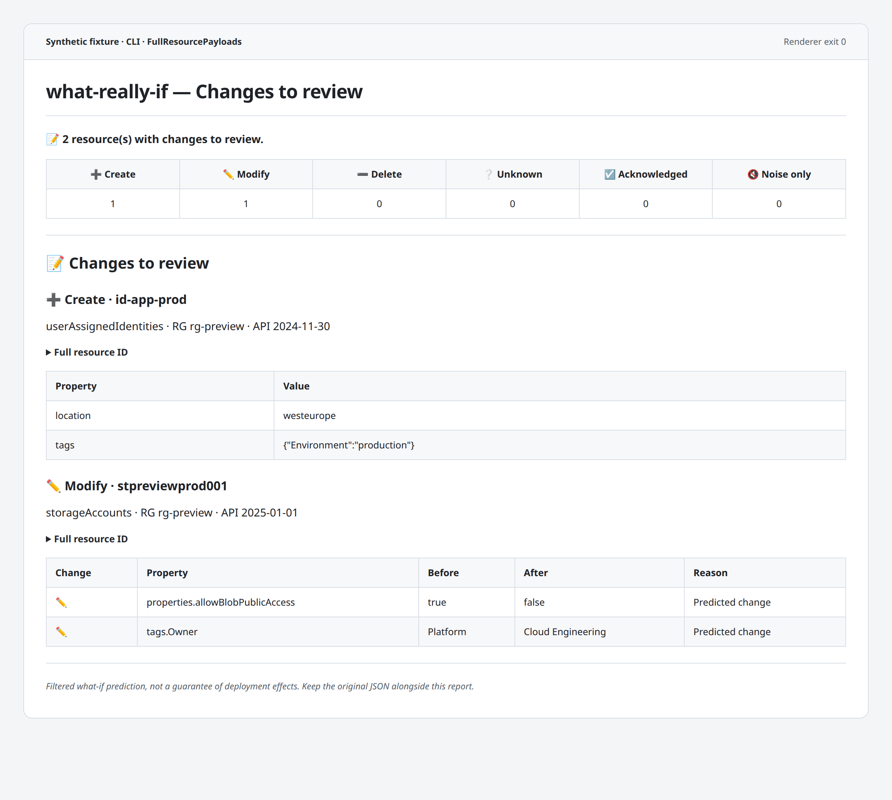
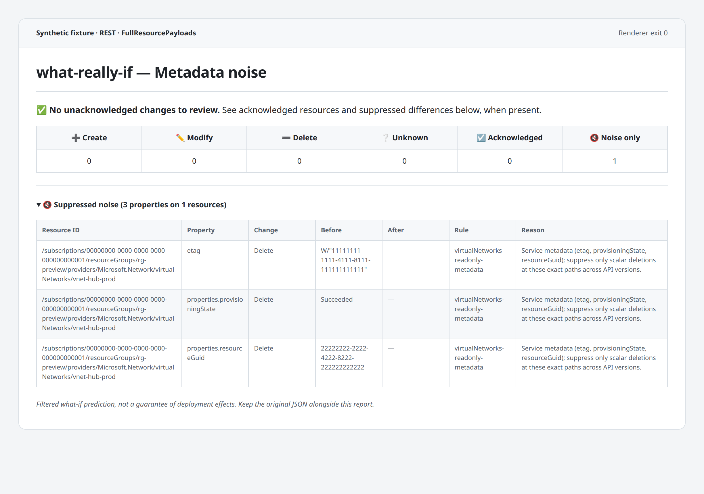
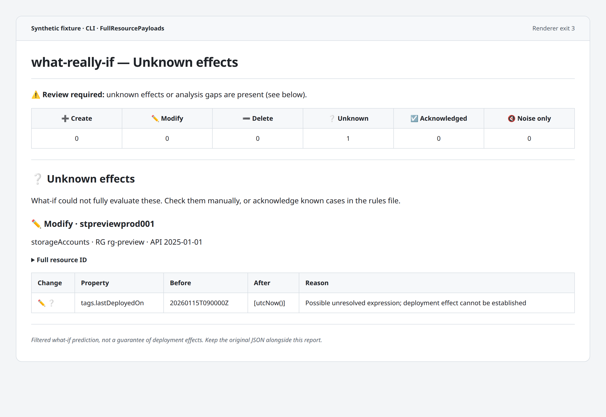

# what-really-if

Bicep What-If can turn a one-line change into the complete autobiography of your
Application Gateway. Add a few more resources and reading the preview becomes a
full-day job.

**what-really-if** turns that output into readable Markdown for deployment
approvals, filtering known metadata noise and flagging changes Azure couldn't
evaluate.

## Preview

Screenshots of reports generated from [reusable synthetic What-If mocks](tests/mocks/README.md),
checked against Microsoft's published result contract and snapshot/delta consistency.
The styling is local Markdown presentation; these are not captured Azure deployments.

**Changes to review** — identity creation and a storage configuration change.



**Metadata noise** — every suppressed path remains visible with its rule and reason.



**Unknown effects** — an unresolved expression stays visible and returns exit `3`.




## Requirements

- [jq](https://jqlang.org/) 1.6+ on `PATH`.
- Bash or PowerShell 7.2+.
- Azure CLI to capture the preview; rendering works offline.

Clone or download this repository. Keep your chosen script, `what-really-if.jq`,
and `what-really-if.json` in the same directory. Both scripts use the same engine
and rules.

## Usage

### Bash

```bash
set -euo pipefail

az deployment group what-if \
  --resource-group my-rg \
  --template-file main.bicep \
  --parameters @parameters.json \
  --no-pretty-print \
  --result-format FullResourcePayloads > whatif.json

./what-really-if.sh \
  --input whatif.json \
  --output whatif.md \
  --summary-file whatif-summary.json
```

### PowerShell

```powershell
az deployment group what-if `
  --resource-group my-rg `
  --template-file main.bicep `
  --parameters '@parameters.json' `
  --no-pretty-print `
  --result-format FullResourcePayloads |
    Set-Content -LiteralPath whatif.json -Encoding utf8NoBOM

if ($LASTEXITCODE -ne 0) { throw 'Azure What-If failed.' }

./what-really-if.ps1 `
  -InputFile whatif.json `
  -OutputFile whatif.md `
  -SummaryFile whatif-summary.json
```

Use `sub`, `mg`, or `tenant` instead of `group` for other deployment scopes.
Existing Azure CLI or REST JSON results are also accepted.

| Option | Bash | PowerShell |
|---|---|---|
| Custom rules | `--config project-rules.json` | `-ConfigFile project-rules.json` |
| Report title | `--title 'My deployment'` | `-Title 'My deployment'` |
| Optional JSON summary | `--summary-file summary.json` | `-SummaryFile summary.json` |
| Help | `--help` | `-Help` |

## Filtering

- **Suppressed:** explicit `NoEffect` changes and scalar metadata deletions at
  verified paths on supported resource types, subject to each rule’s API-version
  constraints.
- **Visible:** resource creates/deletes, configuration changes, structural
  object/array changes unless explicitly allowed by a structural rule, and
  differences without a matching rule.
- **Flagged for review:** possible unresolved expressions, incomplete analysis,
  unsupported results, and missing expected details. `Ignore` and `Deploy`
  entries are handled conservatively.

The enabled defaults cover selected metadata on Azure networking resources
(including nested Application Gateway components), storage accounts, and
user-assigned managed identities. See the [rules](what-really-if.json) and
[path catalogue](tests/fixtures/safe-default-paths.json) for exact paths,
researched API versions, and pinned Microsoft specification sources. Exact
`etag`, `provisioningState`, and `resourceGuid` paths match across API versions,
including when the payload omits its version. Other metadata, such as storage
`creationTime` and managed identity identifiers, remains version constrained.
A rule without `apiVersions` matches any version; a rule with that field only
matches a listed version.

Every suppressed difference remains in a collapsible section with its rule and
reason. Long values are truncated; keep the raw JSON for full details. What-If
remains a prediction, and filtering cannot resolve unknown deployment effects.

## Configuration

Edit `what-really-if.json`, or pass a project-specific copy. Each rule requires:

- A unique `id`, boolean `enabled`, and explanatory `reason`.
- An exact `resourceType`, anchored `pathRegex`, and `changeTypes` array.

Optional `apiVersions`, `beforeEquals`, `beforeIn`, and `afterEquals` narrow the match.
`beforeIn` is a nonempty array of allowed JSON values, for example
`[false, "None", "Regional"]`. Values match exactly, including their JSON types;
`false` does not match `"false"`. Use either `beforeEquals` or `beforeIn`, not both.
These constraints do not bypass missing-value or unresolved-expression checks.
Resource types match case-insensitively; paths and string values are
case-sensitive. The first matching enabled rule wins. Array paths use numeric
indexes, such as `properties.httpListeners[0].properties.provisioningState`.

Set a rule's `enabled` to `false` to disable it. Set `rules` to `[]` to remove
metadata suppressions while retaining explicit `NoEffect` handling when using a
standalone configuration.

### Extend the defaults

A project can inherit bundled defaults without copying them:

```json
{
  "extends": "default",
  "rules": [
    {
      "id": "project-parent-subnets",
      "enabled": true,
      "resourceType": "Microsoft.Network/virtualNetworks",
      "pathRegex": "^properties\\.subnets$",
      "changeTypes": ["Delete"],
      "allowStructural": true,
      "reason": "Parent view of child subnets deployed separately by this template"
    }
  ]
}
```

Pass this file using `--config` or `-ConfigFile`. Top-level project settings
replace inherited settings. Project rules run first. A project rule with the
same `id` replaces the inherited rule entirely. To disable a default, supply
its full rule object with `enabled: false`. Omitted lists and empty project lists retain inherited
rules. Without `extends`, the configuration replaces the defaults completely.
Only `"extends": "default"` is supported; arbitrary files are not loaded.

### Structural rules

Rules normally suppress only scalar values. `allowStructural: true` explicitly
permits matching objects and arrays, for example **the parent's view of child
resources** deployed separately. Use exact resource types and narrow paths,
with a reason explaining the separate deployment. This option does not prove
that the child resources are present in the deployment. It cannot hide resource
creates/deletes, unresolved expressions, or missing expected values. Value
constraints such as `beforeEquals` and `beforeIn` still apply.

### Reviewed unsupported resources

Known unsupported entries can remain in the report without triggering exit `3`:

```json
{
  "extends": "default",
  "acknowledgeUnsupported": [
    {
      "id": "known-role-assignment",
      "enabled": true,
      "resourceIdRegex": "^/subscriptions/s/resourceGroups/rg/providers/Microsoft\\.Authorization/roleAssignments/known-id$",
      "unsupportedReasonRegex": "^Known provider limitation$",
      "reason": "Reviewed this assignment separately; tracked in the project deployment review"
    }
  ]
}
```

Use the actual resource ID and unsupported reason from your captured JSON.
`id`, `enabled`, `resourceIdRegex`, and a nonempty `reason` are required.
`unsupportedReasonRegex` is optional; when supplied, **both** regexes must match.
Use anchored expressions for specific known cases. Omitting the reason matcher
acknowledges any unsupported reason for the matching resource IDs.

The first matching enabled acknowledgement wins. A new resource or a changed
reason that no longer matches still requires review. Independent diagnostics and
incomplete or reviewable property deltas still require attention. Acknowledged
entries appear in a collapsible section with the full ID, original issue,
matching rule ID, and review reason; the summary includes `acknowledgedResources`.
They are acknowledged analysis gaps, not evaluated deployment effects.

Reports use short resource names and property tables for Create/Delete. Full
resource IDs remain available in collapsible details. Expression IDs are parsed
only for literal type arguments of the outer `resourceId(...)` call; uncertain
forms use the payload type or `Unknown` rather than guessing from nested calls.

## Pipeline integration

| Exit code | Meaning |
|---|---|
| `0` | Report generated without unacknowledged unknown effects or analysis gaps. May contain changes requiring approval. |
| `2` | Invalid input/configuration, unsuccessful What-If operation, or rendering failure. |
| `3` | Report generated with unknown effects or analysis gaps requiring review. |

Publish the Markdown, raw JSON, and optional summary on codes `0` and `3`.
On code `2`, do not publish an older report left at the output path. With Bash
`set -e`, capture the renderer's status using `report_status=0` followed by
`./what-really-if.sh ... || report_status=$?`. In PowerShell, save `$LASTEXITCODE`
immediately after invoking the script.

The JSON summary provides counts, `hasReviewChanges`, `hasUnknown`, and global
`analysisIssues`. Exit code `0` is not deployment approval. Deploy the same
artifact, parameters, scope, and mode used for the preview.

### Azure DevOps

This PowerShell example publishes the report on exit `0` or `3`. Replace the
service connection, resource group, template, and parameters with your values.

```yaml
steps:
- task: AzureCLI@2
  inputs:
    azureSubscription: 'my-service-connection'
    scriptType: pscore
    scriptLocation: inlineScript
    inlineScript: |
      $reportDir = "$(Build.ArtifactStagingDirectory)/what-if"
      New-Item -ItemType Directory -Path $reportDir -Force | Out-Null
      az deployment group what-if `
        --resource-group my-rg `
        --template-file main.bicep `
        --parameters '@parameters.json' `
        --no-pretty-print `
        --result-format FullResourcePayloads |
          Set-Content -LiteralPath "$reportDir/whatif.json" -Encoding utf8NoBOM
      if ($LASTEXITCODE -ne 0) { throw 'Azure What-If failed.' }

      ./what-really-if.ps1 `
        -InputFile "$reportDir/whatif.json" `
        -OutputFile "$reportDir/whatif.md" `
        -SummaryFile "$reportDir/summary.json"
      $reportStatus = $LASTEXITCODE
      if ($reportStatus -notin @(0, 3)) {
        throw "Report generation failed with exit code $reportStatus"
      }
      Write-Host "##vso[task.uploadsummary]$reportDir/whatif.md"
      if ($reportStatus -eq 3) {
        Write-Warning 'What-If contains unknown effects requiring review.'
      }
      # AzureCLI@2 propagates LASTEXITCODE; retain the report without failing on 3.
      $global:LASTEXITCODE = 0
- task: PublishPipelineArtifact@1
  inputs:
    targetPath: '$(Build.ArtifactStagingDirectory)/what-if'
    artifact: what-if
```

The default success condition skips artifact publication if rendering fails
with exit `2`, so an older report is not published. This example leaves the
approval decision to the review process; exit `3` still needs investigation.

## Tests

```bash
bash tests/test-what-really-if.sh
WHAT_REALLY_IF_RUNNER=powershell bash tests/test-what-really-if.sh
```

The test harness requires Bash and jq; the second command also requires `pwsh`.
Tests use synthetic JSON fixtures and do not perform live Azure deployments.
The reusable documentation mocks also have a standard-library consistency check:
`python3 tests/validate-mocks.py`.

Under Git Bash on Windows, the path fixture uses an ASCII directory name to
avoid native jq command-line Unicode decoding issues. It still checks spaces,
brackets, quoted arguments, and Unicode report content. Other platforms also
exercise Unicode filenames.
